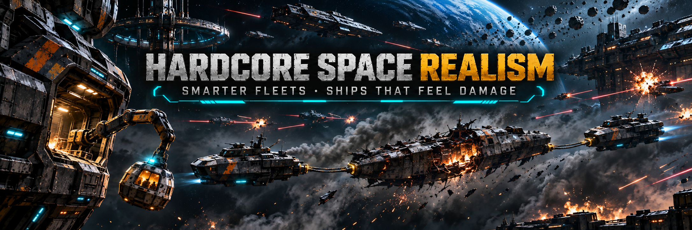

# Hardcore Space Realism for SpaceBourne 2

A [UE4SS](https://github.com/UE4SS-RE/RE-UE4SS) Lua mod: the space counterpart of
[Hardcore Tactical Realism](https://github.com/hubertdungen/SpaceBourne2-HardcoreTacticalRealism).
Everything is on by default, automatic, with no keys and no menus. Part of the SpaceBourne 2 realism set.

> **Status: 0.2.0.** The ally pod catchers are on by default. The enemy doctrine and the smarter allied
> ships are in but **off by default** until they have been tested in the game (each has its own switch in
> `config.lua`). Ship damage that matters is planned. [DESIGN.md](DESIGN.md) has the research.

## What it does

**Ally pod catchers (0.1.0).** When a ship dies its pilot ejects in a rescue pod. The game lets only
you catch it: with your mothership's pod catcher perk or the pod catcher item. With this mod an
allied ship that is closer to a free pod than you are, and within range, catches it. The pilot goes
to **your** captives, exactly as if you had caught it. Nothing is caught when your captive slots are
full or when your own mothership perk is on (it already takes every free pod).

**Enemy doctrine by tier (0.1.0, off by default).** In the game every enemy fighter and frigate ends its
run with a "close pass": it doubles its speed and dives at you. With this on, the low tiers (pirates, and
ranks up to `LowRank`) never do that, so they keep shooting from their normal attack distance, and they
turn a little slower (sloppy). Higher ranks of the military factions fly as the game has them. Switch it
on with `EnemyDoctrine.Enabled = true`; it becomes the default once it has been tested.

**Smarter allied ships (0.2.0, off by default).** In the game an allied fighter or frigate fights until it
dies. With this on, an ally whose armor and shield are below 25 % pulls back with the game's own "return to
spawn" flag (it flies to where it came from, or to your ship, and the game stops it there). It rejoins when
it is above 60 % again (shields recharge by themselves) or after two minutes, whichever comes first. Allies
that are not in a squad also attack the target you have locked, once per new target. Never touched: your
ship, enemies, aliens, civilians, cargo, drones, capital ships, command and mother ships. Switch it on with
`AlliedShips.Enabled = true`; it becomes the default once it has been tested.

*Planned, not yet in:*
- **Ship damage that matters:** a ship that has lost hull flies and turns worse and recharges its shield slower.

## Settings

Edit `HardcoreSpaceRealism/scripts/config.lua`, save, restart the game.

| Setting | Default | |
|---|---|---|
| `Enabled` | `true` | Master switch. |
| `PodCatchers.Enabled` | `true` | Allied ships catch free pods. |
| `PodCatchers.Range` | `5000` | Metres. An ally this close to a pod, and nearer than you, catches it. |
| `PodCatchers.Interval` | `2.5` | Seconds between checks. |
| `EnemyDoctrine.Enabled` | `false` | Low-tier enemies skip the close pass and turn slower. |
| `EnemyDoctrine.LowRank` | `1` | Enemy rank up to this is low tier (pirates always are). |
| `EnemyDoctrine.SloppyTurn` | `0.85` | Low-tier turn speed multiplier (1 = unchanged). |
| `EnemyDoctrine.Interval` | `3.0` | Seconds between scans. |
| `AlliedShips.Enabled` | `false` | Allies retreat when badly damaged and attack your locked target. |
| `AlliedShips.Retreat.Enabled` | `true` | Retreat part of the above. |
| `AlliedShips.Retreat.Below` | `0.25` | Health ratio (armor + shield) under which an ally pulls back. |
| `AlliedShips.Retreat.ResumeAbove` | `0.6` | It rejoins the fight above this. |
| `AlliedShips.Retreat.MaxSeconds` | `120` | It rejoins after this long whatever its health (then waits 60 s). |
| `AlliedShips.Retreat.MaxDistance` | `3000` | Metres from its root. Farther away it stays in the fight. |
| `AlliedShips.ShareTarget.Enabled` | `true` | Allies outside a squad attack your locked target. |
| `AlliedShips.ShareTarget.Range` | `20000` | Metres from you: only allies this close are told. |
| `AlliedShips.Interval` | `3.0` | Seconds between scans. |
| `Debug` | `false` | Writes what the mod does to `hardcorespacerealism.log`. |

## Works with Bigger Armies

Bigger Armies 0.2.0 had the same pod catchers. If it is installed and on with its `PodCatchers`
setting on, this mod leaves the pods to it and says so once in its log. Bigger Armies 0.2.1 and
later no longer has them: update it and this mod takes over.

## Install

**A. SpaceBourne 2 Realism installer (recommended)**
The [installer](https://github.com/hubertdungen/SpaceBourne2-Realism) installs UE4SS if you don't have
it, switches the mods you tick on and keeps them updated.

**B. By hand**
1. Install UE4SS 3.0.1 for SpaceBourne 2: put `dwmapi.dll`, `UE4SS.dll` and `UE4SS-settings.ini` in
   `SB2\Binaries\Win64`.
2. Copy the `HardcoreSpaceRealism` folder to `SB2\Binaries\Win64\Mods`.
3. Add the line `HardcoreSpaceRealism : 1` to `Mods\mods.txt` (or keep the empty `enabled.txt` in
   the mod folder).

## Limits

- Pod catching uses the game's own `CatchByMother` call, so the pod flies to the allied ship and the
  game's own catcher drone animation runs under your ship.
- A catch can complete the mission objective "catch a pod" (the game's own rule for any catch).
- The pod catchers were tested with scripted allies and pods (in Bigger Armies 0.2.0, same code); a real fleet
  fight is not tested yet. The enemy doctrine and the smarter allied ships are not tested in the game yet
  (that is why they are off by default).
- Retreat uses the game's own "return to spawn" flag. Whether a ship inside a squad follows it is not known yet.

## Compatibility

Pure Lua, no game files replaced. Timed work uses `gametick.lua` (no `LoopAsync`), the same
timer every mod of the set shares, so the mods do not step on each other.

## How it works

The mod looks for free pods (the game tags them `FreePod`) every few seconds on the game thread. When
an ally ship is nearest, it calls the pod's own `CatchByMother` with that ship, the same call the
mothership perk makes. Details: [DESIGN.md](DESIGN.md). Version history: [CHANGELOG.md](CHANGELOG.md).

## The SpaceBourne 2 realism set

Separate mods that work alone or in any combination. The
[SpaceBourne 2 Realism installer](https://github.com/hubertdungen/SpaceBourne2-Realism)
([Nexus](https://www.nexusmods.com/spacebourne2/mods/11)) installs the ones you tick and keeps them updated.

- **[Hardcore Tactical Realism](https://github.com/hubertdungen/SpaceBourne2-HardcoreTacticalRealism)**
  ([Nexus](https://www.nexusmods.com/spacebourne2/mods/4)): realistic ballistics, wounds and tactical AI. The core of the set.
- **Hardcore Space Realism** (this mod): realism for ships and space combat.
- **[Silent Ops](https://github.com/hubertdungen/SpaceBourne2-SilentOps)**
  ([Nexus](https://www.nexusmods.com/spacebourne2/mods/6)): stealth, silent takedowns and suppressors.
- **[Ammo Discipline](https://github.com/hubertdungen/SpaceBourne2-AmmoDiscipline)**
  ([Nexus](https://www.nexusmods.com/spacebourne2/mods/12)): carried ammo limits and scavenging, so every magazine counts.
- **[Gear Without Levels](https://github.com/hubertdungen/SpaceBourne2-GearWithoutLevels)**
  ([Nexus](https://www.nexusmods.com/spacebourne2/mods/7)): use gear above your level, with small handling penalties.
- **[Tactical First Person](https://github.com/hubertdungen/SpaceBourne2-TacticalFirstPerson)**
  ([Nexus](https://www.nexusmods.com/spacebourne2/mods/15)): first person on foot, weapons held up, aiming down the sights.
- **[Tactical Engineering](https://github.com/hubertdungen/SpaceBourne2-TacticalEngineering)**
  ([Nexus](https://www.nexusmods.com/spacebourne2/mods/10)): realistic deployable turrets.
- **[Get Out of the Way](https://github.com/hubertdungen/SpaceBourne2-GetOutOfTheWay)**
  ([Nexus](https://www.nexusmods.com/spacebourne2/mods/14)): NPCs step aside naturally when you walk through them.
- **[Ground Waypoints](https://github.com/hubertdungen/SpaceBourne2-GroundWaypoints)**
  ([Nexus](https://www.nexusmods.com/spacebourne2/mods/13)): planet waypoints on foot and on the hoverbike.
- **[Faction Power](https://github.com/hubertdungen/SpaceBourne2-FactionPower)**
  ([Nexus](https://www.nexusmods.com/spacebourne2/mods/9)): dungeons, strategic sales and missions earn your faction power.
- **[Bigger Armies](https://github.com/hubertdungen/SpaceBourne2-BiggerArmies)**
  ([Nexus](https://www.nexusmods.com/spacebourne2/mods/17)): twice the general slots for your faction's ground and space forces.
- **[Clear HUD](https://github.com/hubertdungen/SpaceBourne2-ClearHUD)**
  ([Nexus](https://www.nexusmods.com/spacebourne2/mods/16)): a reticle you can see and HUD colours of your choice.
- **[Split Controls](https://github.com/hubertdungen/SpaceBourne2-SplitControls)**
  ([Nexus](https://www.nexusmods.com/spacebourne2/mods/5)): separate vertical invert for ship and on foot, per device.
- **[SB2 HOTAS](https://github.com/hubertdungen/SpaceBourne2-HOTAS)**
  ([Nexus](https://www.nexusmods.com/spacebourne2/mods/8)): HOTAS, rudder pedals, triple screens and head tracking.
- **[Squad Tactics](https://github.com/hubertdungen/SpaceBourne2-SquadTactics)**
  ([Nexus](https://www.nexusmods.com/spacebourne2/mods/18)): squad orders on foot: teams, point at a spot and give orders, rescue me.
- **[Unofficial Patch](https://github.com/hubertdungen/SpaceBourne2-UnofficialPatch)**
  ([Nexus](https://www.nexusmods.com/spacebourne2/mods/19)): fixes for game bugs, such as squad mates stuck or misplaced in lifts.

## License

MIT. See [LICENSE](LICENSE).
